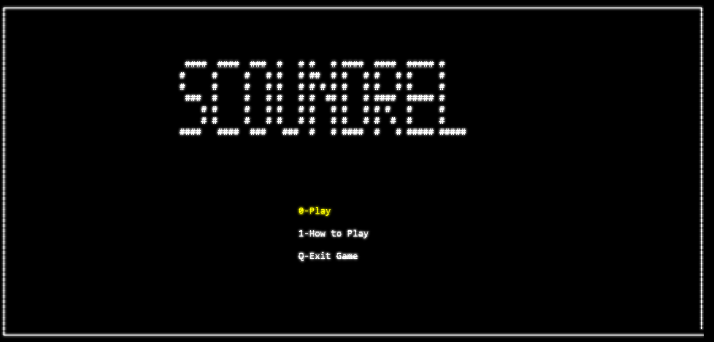
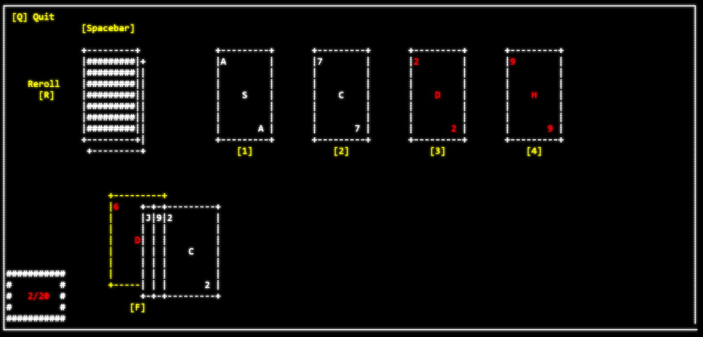

# Scoundrel (Terminal Edition)


Una implementación en **C++** para terminal del juego de cartas *roguelike* en solitario **Scoundrel**, diseñado originalmente por Zach Gage y Kurt Bieg. Desarrollado con gráficos en arte ASCII a color mediante la librería **PDCurses**.

---




## Características

- **Interfaz en terminal a color:** Cartas, bordes, barra de vida y controles renderizados en ASCII con resaltado dinámico.
- **Mazo fiel a las reglas originales:** Baraja de 44 cartas generada y mezclada aleatoriamente en cada partida.
- **Sistema completo de combate y equipamiento:** Gestión visual del arma equipada, historial de monstruos derrotados con ella y opción de atacar desarmado o con arma.
- **Sistema de puntuación:** Cálculo automático de puntuación tanto en victoria (vida restante + bonificación) como en derrota (valor negativo de los monstruos restantes en la mazmorra).
- **Menú interactivo e instrucciones integradas:** Navegación completa por teclado con pantalla de reglas dentro del propio juego.

---

## Reglas del Juego

Scoundrel se juega con un mazo modificado de **44 cartas** (se eliminan los comodines, las figuras rojas y los ases rojos). Empiezas con **20 puntos de vida (HP)** y tu objetivo es limpiar toda la mazmorra.

### Tipos de cartas
| Palo | Símbolo | Función | Valores |
| :--- | :---: | :--- | :---: |
| **Picas y Tréboles** | `S` / `C` | **Monstruos:** Infligen daño igual a su valor. | `2–10`, `J(11)`, `Q(12)`, `K(13)`, `A(14)` |
| **Diamantes** | `D` | **Armas:** Se equipan para reducir el daño recibido. | `2–10` |
| **Corazones** | `H` | **Pociones de vida:** Restauran vida hasta el máximo de 20. | `2–10` |

### Mecánica de salas y combate
1. **Salas:** En cada turno se revelan cartas hasta formar una sala de **4 cartas**. Debes resolver **3 de ellas** para avanzar; la cuarta carta permanece como base de la siguiente sala.
2. **Evitar salas (Reroll):** Puedes devolver las cartas de una sala al fondo del mazo y robar 4 nuevas, pero **no puedes hacerlo dos veces seguidas**.
3. **Combate con armas:** Al atacar a un monstruo con un arma equipada, solo recibes la diferencia de daño (`Valor Monstruo - Valor Arma`). Sin embargo, cada monstruo que derrotes con esa misma arma debe ser de **menor valor** que el último monstruo derrotado con ella.
4. **Combate desarmado:** Siempre puedes luchar sin arma, pero recibirás el daño completo del monstruo.
5. **Victoria y Derrota:** Ganas si consigues vaciar el mazo y la sala con vida restante. Pierdes si tu vida llega a `0`.

---

## Controles

### Menú Principal
| Tecla | Acción |
| :---: | :--- |
| `W` / `↑` y `S` / `↓` | Navegar por las opciones |
| `Enter` / `Espacio` | Seleccionar opción |
| `Q` | Salir del juego |

### En Partida
| Tecla | Acción |
| :---: | :--- |
| `Espacio` | Robar cartas iniciales / Rellenar la sala (cuando queda 1 carta o menos) |
| `1`, `2`, `3`, `4` | Seleccionar y jugar la carta en esa posición |
| `F` | Activar / Desactivar el uso del arma equipada (se resalta en amarillo) |
| `R` | Evitar la sala actual (*Reroll*) |
| `Q` | Volver al menú principal |

---

## Estructura del Proyecto

```text
Scoundrel/
├── main.cpp            # Bucle principal, menús, pantallas de victoria/derrota e inicialización de curses
├── headers/
│   ├── card.h          # Definición de la clase Card (renderizado y atributos)
│   ├── deck.h          # Definición de la clase Deck (mazo, salas y puntuación)
│   ├── player.h        # Definición de la clase Player (vida, armas y combate)
│   └── layout.h        # Funciones de dibujo de la interfaz general
├── sources/
│   ├── card.cpp
│   ├── deck.cpp
│   ├── player.cpp
│   └── layout.cpp
├── resources/
│   ├── BlankCard       # Plantilla para cartas
└── build.bat           # Script de compilación y ejecución para Windows (TDM-GCC + PDCurses)
```

---

## Requisitos y Compilación

### Windows (Recomendado)

#### Requisitos previos
- Compilador **g++** (MinGW-w64 o TDM-GCC).
- Librería **PDCurses** instalada (archivos de cabecera `.h` y librería estática `pdcurses.a`).

#### Compilar usando el script incluido
1. Clona el repositorio:
   ```bash
   git clone https://github.com/XDMG13/Scoundrel.git
   cd TU_REPOSITORIO
   ```
2. Abre el archivo `build.bat` y ajusta las rutas de tu compilador y de PDCurses si es necesario:
   ```bat
   set COMPILER=C:\TDM-GCC-64\bin\g++.exe
   set PDCURSES_INCLUDE=C:\mingw64\include
   set PDCURSES_LIB=C:\mingw64\lib
   ```
3. Ejecuta el script desde la terminal o con doble clic:
   ```bat
   build.bat
   ```
   Esto compilará el proyecto generando `Scoundrel.exe` y lanzará el juego automáticamente.

#### Compilación manual (Windows)
```bash
g++ -g main.cpp sources/*.cpp -I headers -I /ruta/a/pdcurses/include -L /ruta/a/pdcurses/lib -l:pdcurses.a -static -o Scoundrel.exe
```

> **Nota sobre el tamaño de la terminal:** Para una visualización óptima del arte ASCII y las cartas, se recomienda ejecutar el juego en una ventana de terminal de al menos **120 columnas x 30 filas**.

---

## Créditos

- **Diseño original del juego:** [Zach Gage](https://stfj.net/) y Kurt Bieg (*Scoundrel*, 2011).
- **Implementación en C++ / Terminal:** *(Daniel Martínez García / XDMG13)*.

---

## Licencia

Este proyecto está bajo la Licencia MIT.
